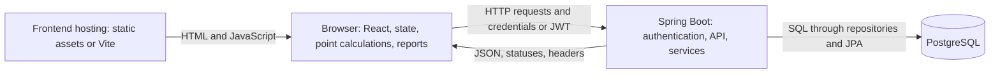
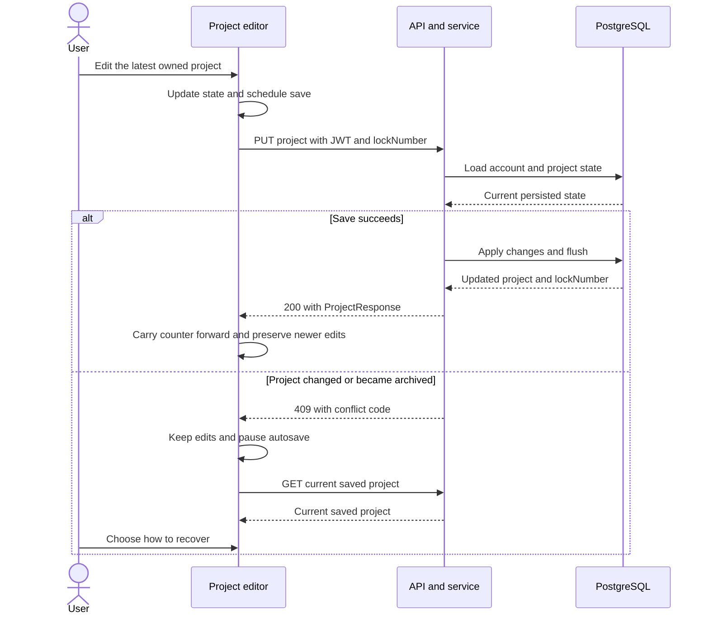

# Benefit architecture

Use this reference to understand the application boundaries and find the code for a change. Read the [development guide](../guides/development.md) to run it; detailed contracts and procedures remain in the linked subsystem references.

## System boundaries

Benefit is a React/TypeScript frontend and a Spring Boot backend with PostgreSQL. The browser owns the editing experience, functional-point calculations, and PDF/CSV generation. The backend owns authenticated access, validation, project persistence, version creation, and session invalidation.

The API is part of the backend, not a separate service between Spring and React. Frontend code and Java code run in different processes and communicate over HTTP.

### Local and hosted deployments

| Environment shape | What changes | What stays the same |
| --- | --- | --- |
| Local Docker | Compose runs Vite, Spring Boot, and PostgreSQL; source directories are mounted. | Browser requests still reach the backend using `VITE_API_URL`. |
| Hosted frontend and backend | GitHub Pages serves assets; a backend host runs Spring and connects to its database. | The browser runs calculations and sends authenticated API requests. |

`VITE_API_URL` and `VITE_BASE_PATH` are frontend build settings. CORS is a backend origin policy. Neither is a replacement for authentication. Consult [deployment guidance](../guides/deployment_guide.md) for actual environment URLs and procedures; hosted settings require verification.

## Code map

| Location | Responsibility |
| --- | --- |
| `frontend/src/components/` | Pages, component editing, summaries, dialogs, and user controls. |
| `frontend/src/context/` and `hooks/` | Login/project context, shared UI state, debouncing, reordering, and other stateful behavior. |
| `frontend/src/api/` | Browser fetch wrappers and translation of API errors into client behavior. |
| `frontend/src/lib/centralizedCalculations.ts` | Shared calculation entry points and totals used by the interface and reports. |
| `frontend/src/lib/calculations.ts`, `fc-constants.ts`, and `fc-service-functions.ts` | Class-specific formulas, configuration, and selection helpers used by the shared calculation path. |
| `frontend/src/lib/quickCalculation.ts` | Quick-calculation defaults and creation of real components through the shared calculations. |
| `frontend/src/lib/*ReportUtils.ts` and `lib/pdf/` | Text-based pdfmake reports, shared layout/data helpers, and runtime. |
| `backend/src/main/java/fi/fisma/backend/api/` | REST controllers: HTTP inputs, outputs, statuses, and service calls. |
| Backend `security/` | Basic sign-in, JWT issuance/validation, revocation, throttling, and account session checks. |
| Backend `service/` | Authorization-sensitive business rules and operations across repositories. |
| Backend `domain/`, `repository/`, and `mapper/` | JPA entities, persistence access, and domain/DTO conversion. |
| Backend `dto/`, `exception/`, and `config/` | API shapes/validation, response errors, and startup/OpenAPI configuration. |
| `backend/src/main/resources/` | Runtime configuration, development initialization, and manual migrations. |

The accepted [backend ADR](adr_backend.md) explains why the backend is organized by layer. Keep business decisions in services as that decision requires.

## State ownership

`AppUserProvider` supplies login/session state, persisted through `authStorage` in localStorage. `ProjectsProvider` supplies accessible projects and version-selection helpers. `ProjectPage` keeps the currently edited project locally, with a ref used by debounced saving.

The browser's edited state can be newer than the last server response. A successful save carries the server's new `lockNumber` forward while preserving edits made during the request. A conflict is a decision point, not permission to replace local state silently.

See [state management](state_management.md) for the detailed pattern. Some examples in that existing reference need updating; compare them with the current `ProjectPage` and hooks, especially deletion responses and ownership checks.

## Follow a project save

Manual and debounced saves share `persistProject` in `ProjectPage`. Normal autosave waits about five seconds after edits. Component operations can flush pending saves. The backend remains authoritative for owner access, latest-version restrictions, and concurrency even when the UI disables controls.

`lockNumber` is a save counter, while `version` identifies the calculation version. A stale counter is rejected. A project update replaces submitted values; it does not merge arbitrary omitted fields. Component creation/deletion also advance the counter. See the [API concepts](api.md#project-versions-and-locknumber) for the exact client contract.

## Understand the data model

A project row represents one version. Rows sharing an immutable `familyId` form a history. Independently created or duplicated projects get a new family ID, even when their display names match. Renaming updates the accessible versions in that family. Membership has a separate relationship ID, account ID, and `roleInProject`.

Top-level functional components contain children for multi-layer architecture. `orderPosition` controls display order. `previousFCId` points to the predecessor copied during version creation, and `parentFCId` links children within a project. These have different purposes; do not substitute one ID for another.

See the [database diagram](../img/images_for_guides/database_diagram.svg), [database guide](../guides/database.md), and [API field reference](api.md#field-reference). SQL is authoritative for actual database constraints; not every logical ID link is enforced as a SQL foreign key.

## Sessions and authorization

Sign-in uses Basic credentials only at `POST /token` with `X-Benefit-Login: 1`. Subsequent requests use a Bearer JWT. Validation checks durable account state and token revocation, not just the signature and expiry.

Password changes advance the internal `session_version` so old JWTs fail, including the current one. Renewal issues a replacement token and revokes the presented one. Deleting an account also invalidates its sessions. Read [authentication internals](../guides/authentication.md) for the lifecycle and storage boundary.

`ADMIN` is an account role; `OWNER`/`MEMBER` are project roles. Administration does not bypass the service's project-owner checks. View-only members can read calculation data and use exports; comment behavior is separately implemented. The interface makes archived comments read-only even though the current API permits comment mutations for accessible archived projects.

## Find the code for a change

| Change | Start at | Follow through |
| --- | --- | --- |
| Login/session behavior | [AppUserProvider](../../frontend/src/context/AppUserProvider.tsx) and [authorization wrapper](../../frontend/src/api/authorization.ts) | Backend security, account-session validation, and authentication guide. |
| Project save or concurrency | [ProjectPage](../../frontend/src/components/ProjectPage.tsx) and [project wrapper](../../frontend/src/api/project.ts) | ProjectController → ProjectService → mapper/repository and integration tests. |
| Report metadata fields | [ProjectReportFields](../../frontend/src/components/ProjectReportFields.tsx) | Shared project-save path and ProjectRequest validation. |
| Adding/removing/reordering components | [useFunctionalComponents](../../frontend/src/hooks/useFunctionalComponents.ts) and [useComponentReorder](../../frontend/src/hooks/useComponentReorder.ts) | Project state, API wrapper, component service, and ownership/order rules. |
| A point total | [Shared calculations](../../frontend/src/lib/centralizedCalculations.ts) | Class-specific inputs/formulas and independent expected-value tests. |
| PDF output | [Overview report](../../frontend/src/lib/overviewReportUtils.ts) or [calculation report](../../frontend/src/lib/calculationReportUtils.ts) | Shared PDF data/layout helpers and calculation functions. |
| Comments or sharing | CommentsPanel/useProjectComments or ShareProjectModal/ProjectList | Corresponding API wrappers, controllers, and service permissions. |
| A schema change | Domain entity and [development schema](../../backend/src/main/resources/schema-dev.sql) | Manual migration, DTO/mapping impacts, database guidance, and regression checks. |

Do not add a second implementation of a calculation or authorization rule in a convenient UI/report component. Follow the existing shared path and update its callers and documentation together.
